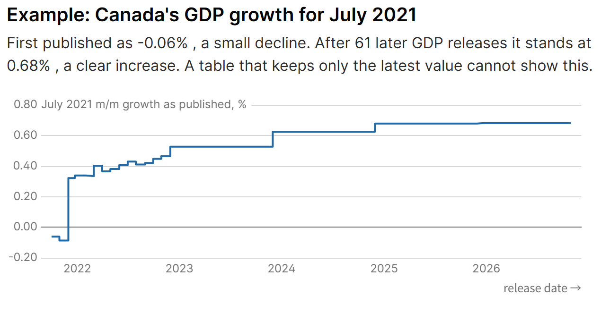
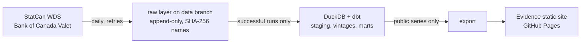

# CanEcon Vintage Pipeline

[](https://github.com/itsChihyeh/canecon-pipeline/actions/workflows/ci.yml) [](https://github.com/itsChihyeh/canecon-pipeline/actions/workflows/collect.yml?query=event%3Aschedule) [](https://github.com/itsChihyeh/canecon-pipeline/actions/workflows/dashboard.yml)

A scheduled Python + SQL pipeline that collects official Canadian economic data (Statistics Canada, Bank of Canada), keeps every published vintage, tracks revisions and lineage from raw API response to dashboard, and publishes a public dashboard.

**Live dashboard:** https://itschihyeh.github.io/canecon-pipeline/ · **dbt docs and lineage:** [dbt-docs](https://itschihyeh.github.io/canecon-pipeline/dbt-docs/) · **Analysis:** [docs/analysis.md](docs/analysis.md) · **Demo script:** [docs/demo-script.md](docs/demo-script.md)

## The problem

Official figures are revised after they are first published. Canada's monthly GDP growth for July 2021 was first reported as a 0.06% decline; it now shows a 0.68% increase. A table that keeps only the latest value cannot say what was known on a given day, or how far first releases move.



This pipeline keeps every published value of every month (a *vintage*), with three separate times: the period it describes, when the source published it, and when we captured it. It answers:

- What was the figure as known on day T, with nothing published after T? (point-in-time)
- How much were first releases revised, and how long until they settle?
- Where did a number on the dashboard come from? (link to the exact raw API response)

Finding so far, for GDP: across 140 months (2015-01 to 2026-08), first-release month-over-month growth moved 0.15 percentage points on average by today, with the right sign in 86% of months; estimates still move after three years, mostly at the annual revisions. Retail sales has no revision history yet. Details and limits in [docs/analysis.md](docs/analysis.md).

## How it works



- **Collect** (GitHub Actions, scheduled 13:47 UTC daily): 3 requests cover 7 series. Retries with backoff; a daily run also catches up earlier missed days; a run is `success` only if every request succeeded.
- **Raw layer**: each response stored once under its SHA-256 on the `data` branch, with a manifest of URL, parameters, capture time and status. Reruns add nothing new when the bytes are the same.
- **Model**: the DuckDB warehouse is rebuilt from the snapshots each time. dbt finds revisions with window functions, ignoring changes of scale or decimals, and computes revision marts and 23 data quality checks. An error-level check fails the build. A new vintage starts only when a value differs from the last vintage kept, so a release with fewer decimals cannot hide a later revision.
- **History**: GDP revisions since 2015 come from Statistics Canada's real-time table 36-10-0491 (140 releases); other series accumulate from 2026-11-07.
- **Dashboard**: only series cleared for publication are exported; the static site is rebuilt after every collection.
- **Code checks**: pytest, ruff (lint and format) and mypy run in CI on every push.
- **Extensions** ([docs/extensions.md](docs/extensions.md)): a language-model monthly brief in which every number must cite a series, period and measure and is checked against the warehouse (34 of 34 briefs passed on the first try in a live run, about $0.04 in total); a scikit-learn baseline for the direction of GDP revisions (no reliable edge found); the pipeline as Dagster assets.

More: [architecture](docs/architecture.md) · [extensions](docs/extensions.md) · [design decisions](docs/design-decisions.md) · [reliability](docs/reliability.md) · [data dictionary](docs/data-dictionary.md) · [sources and terms](docs/sources.md) · [bug log](docs/bug-log.md) · [how this was built](docs/how-this-was-built.md)

Stack: Python 3.12, httpx, DuckDB, dbt (dbt-duckdb), SQL, pytest, ruff, mypy, GitHub Actions, Evidence. Extensions: scikit-learn, Dagster, DeepSeek API.

## Run it

Requires [uv](https://docs.astral.sh/uv/). The tests need no network.

```bash
uv sync
uv run --group orchestration --extra ai pytest -q   # 65 tests; plain `uv run pytest -q` skips the Dagster and DeepSeek ones
uv run canecon-demo-failure      # offline: injected API failures, retry, partial run, catch-up
```

Build the warehouse from the published snapshots:

```bash
git fetch origin data && mkdir -p data/snap && git archive origin/data | tar -x -C data/snap
uv run canecon-build --data-dir data/snap/raw --db data/local/warehouse.duckdb
```

Other commands: `canecon-collect` (one live capture), `canecon-catchup` (fill missed days), `canecon-backfill` (official GDP vintages), `canecon-export` (public tables for the dashboard), `canecon-brief` and `canecon-baseline` (extensions). Dashboard (Node 18+), after `canecon-export`: `cd dashboard && npm ci && npm run sources && npm run dev`.

Checked from a fresh clone of `81a9a3e` on 2026-11-07 (Windows 11, Python 3.12.10, uv 0.11.21, Node 24.17.0): `uv sync --locked`; ruff and mypy clean; 65 tests passed with `--group orchestration --extra ai` (61 passed and 2 skipped without); `canecon-build` on `data` commit `dff27ae` passed with one expected warning (7 series, 2,968 vintages, 23 quality checks) in 62 s, of which dbt's models and tests took 2.8 s; the dashboard built from the same files with `npm run build:strict`.

## Limits

- Only GDP has a long revision history. Retail sales, unemployment, CPI and the Bank of Canada series start on 2026-11-07, so their revision results are still empty.
- Daily collection began on 2026-11-07; there is no long run history or success rate yet.
- Bank of Canada data has no publication time in the API, so its capture time is used (conservative for point-in-time queries).
- An API cannot be re-queried for a past day: a missed day is filled with today's data, and a StatCan table released twice inside a gap would lose the earlier vintage.
- USD/CAD was collected until 2026-11-07 and then dropped: the Bank of Canada sources it from LSEG, and its terms do not license third-party content for reuse. Raw snapshots up to that date still contain it, because rewriting the public append-only history would break the SHA-256 lineage; it is never loaded into the warehouse or shown.
- A personal portfolio project built with an AI coding assistant; not used by any organisation. See [how this was built](docs/how-this-was-built.md).

## Data attribution

Adapted from Statistics Canada data. This does not constitute an endorsement by Statistics Canada of this product. Bank of Canada data: source Bank of Canada; values may be transformed as described in the docs.
