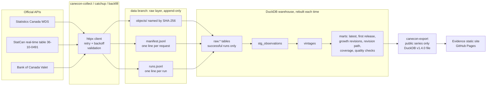

# Architecture

## Layers

**Collector** (`src/canecon/collect.py`, `sources.py`, `faults.py`). One run sends a fixed set of requests: StatCan `getDataFromVectorsAndLatestNPeriods` and `getSeriesInfoFromVector` for the four StatCan vectors, and one Valet request for the four Bank of Canada series. Retryable failures (409, 429, 5xx, network) get up to 4 attempts with 2 s, 4 s, 8 s waits. A 200 response that cannot be used (bad JSON, StatCan status not `SUCCESS`, empty Valet list) counts as a failure. A run is `success` only if every request succeeded; otherwise it is `partial` or `failed` and the exit code is non-zero.

**Raw layer** (the `data` branch, folder `raw/`). Each response body is stored once under `objects/` with its SHA-256 as the file name. `manifest.jsonl` gets one line per request: source, URL and parameters, capture time (UTC), HTTP status, hash, and whether the object was new. `runs.jsonl` gets one line per run with its status and the collection days it covers. Nothing is ever rewritten. A rerun with identical responses adds manifest lines but no objects.

**Warehouse** (`src/canecon/load.py`, `build.py`, `dbt/`). `canecon-build` creates a fresh DuckDB file from the raw layer every time, so the warehouse is a pure function of the snapshots. The loader reads only captures that belong to `success` runs. dbt then runs:

- `stg_observations`: typed values, `value_scaled = value x 10^scalar_factor`, and `precision_step`, the smallest change the source can express.
- `vintages`: one row per distinct published value of (series, reference period). A recursive CTE walks each (series, period) in order of publication then capture time and carries the last value kept; a value starts a new vintage only if it differs from that one after rounding both to the coarser precision, so a change of scale factor or decimals is not a revision. `LEAD` then sets the validity intervals. Each vintage carries `valid_from` / `valid_to` and the hash of the snapshot it came from.
- marts: latest value, first release, level and growth revisions, the growth of each month at every later release, collection coverage per day, freshness, and `mart_quality_checks`.

dbt tests (`dbt/tests/` plus schema tests in the `.yml` files) check that vintage intervals of a period do not overlap, that consecutive vintages really differ, that every lineage hash has a raw object, that every series is catalogued and documented, and that no quality check is at error level (which fails the build).

**Point-in-time** (`src/canecon/pit.py`). `as_of(con, T)` returns the vintage with `valid_from <= T < valid_to` for every series and period, so nothing published after T is used.

**Export and dashboard** (`src/canecon/export.py`, `dashboard/`). `canecon-export` copies only series with `public_dashboard = true` into a small DuckDB file in storage format v1.4.0, which the dashboard's bundled DuckDB can read. Evidence turns SQL in Markdown pages into a static site.

## Schedules (GitHub Actions)

| Workflow | Trigger | Does |
|---|---|---|
| `CI` | every push to `main`, pull requests | `uv sync --locked`, `ruff check`, `ruff format --check`, `mypy`, `pytest` |
| `Daily collect` | 15:00 UTC daily, or by hand (`daily`, `catchup`, `backfill_gdp`) | collect, commit new snapshots to `data`, rebuild the warehouse and run the checks; the job fails if a request or an error-level check failed |
| `Dashboard` | after `Daily collect`, on dashboard/model/code pushes, or by hand | rebuild from `data`, export, build the Evidence site and the dbt docs (`/dbt-docs/`), deploy to Pages |

## Lineage of one number

A value on the dashboard's revision explorer shows its vintage's `source_snapshot_sha256`. That hash is the file name under `raw/objects/` on the `data` branch, and `manifest.jsonl` has the URL, parameters and capture time of the request that returned it. The dashboard links each vintage to that file on GitHub, using the `data` commit recorded in `build_info`.
